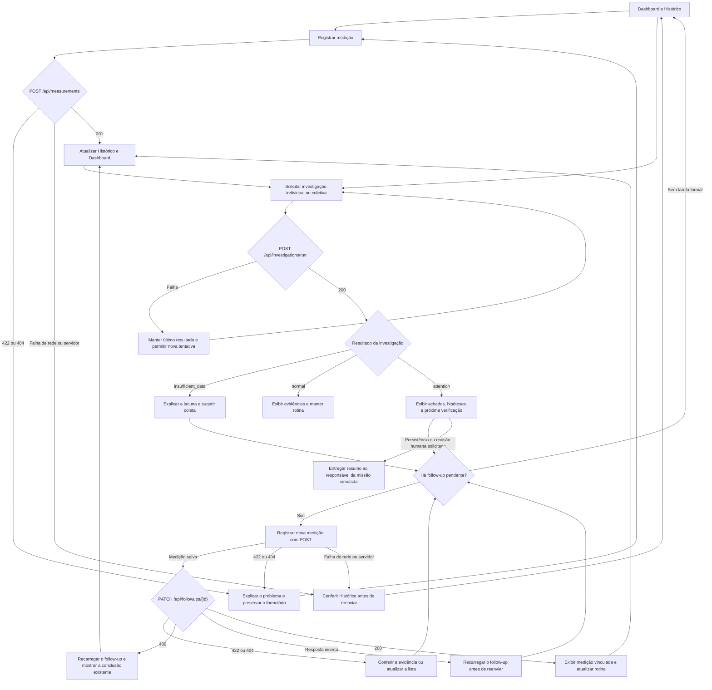

# AKM-04 · Fluxo ponta a ponta da investigação

Esta especificação acompanha a arquitetura v2.0 e o adendo v2.1 (internal Notion page; Portuguese, not part of the submission). Usa as evidências e limites da [AKM-07](../scientific-sources.md) para definir como a tripulação fictícia da ODYSSEY-26 registra, interpreta, verifica e reanalisa uma observação.

## Fluxograma

Os estados de carregamento, vazio e erro pertencem à interface. O resultado usa `normal`, `attention` ou `insufficient_data` no fluxo P0. O código `critical` permanece reservado no contrato. Status levam texto e ícone, junto da cor.

## Transições e responsabilidades

| Etapa | Resposta ou estado | Comportamento esperado |
| --- | --- | --- |
| Abrir Dashboard | Vazio ou leitura disponível | Exibir estado vazio com `insufficient_data`. Com banco vazio e sem investigação, `has_unanalyzed_measurements=false`. Carregar o histórico com os filtros selecionados e mostrar horários e unidades. |
| Registrar dados | `POST /api/measurements` → 201 | Validar tipo, unidade, alvo e horário. Tripulante exige ID e habitat usa `null`. O backend deriva `measurement_zone` e define `recorded_at`. Atualizar o histórico imediatamente. Se houver dado válido ainda fora da última análise do escopo, indicar nova medição e oferecer a ação de investigar. |
| Investigar | `POST /api/investigations/run` → 200 | Enviar `scope=crew` ou `scope=individual` com astronauta. O backend seleciona as entradas válidas, usa a versão de regras e devolve achados, evidências, hipóteses não confirmadas e próxima verificação. Atualizar o Dashboard e permitir recuperar o resultado com `GET /api/investigations/{id}`. |
| Repetir a análise | Mesmo fingerprint, `reused=true` | Preservar o ID da investigação e seu follow-up. Com dados novos, calcular outra fingerprint. Se houver follow-up pendente equivalente para tipo e alvo, reutilizá-lo. |
| Interpretar o resultado | `normal`, `attention` ou `insufficient_data` | `normal` indica ausência de padrão na regra para o escopo avaliado. Em `attention`, separar observação de hipótese e mostrar a razão da próxima coleta. Sem base suficiente, solicitar a informação que falta. CO₂ suspeito, ausente ou fora da janela limita a hipótese ambiental e pode coexistir com achado válido de sono. |
| Verificar | `POST /api/measurements` → 201, depois `PATCH /api/followups/{id}` → 200 | Só enviar `{"status":"completed","measurement_id":123}` após confirmar a medição persistida. A medição deve ter qualidade `ok`, `recorded_at` posterior à solicitação e tipo, zona e astronauta compatíveis. O backend retorna `measurement_id` e `completed_at`. |
| Retentar a conclusão | 200, 422, 404 ou 409 | A mesma medição devolve a conclusão existente. Medição incompatível recebe 422 e mantém o pendente. Com 404, atualizar lista e conferir os IDs. Se outra medição já concluiu o item, 409 e recarga da conclusão atual. Em resposta incerta, recarregar o follow-up antes de outra ação. |
| Reanalisar e atualizar rotina | Nova investigação explícita | A tarefa concluída sai da lista de pendentes e fica rastreável pela medição. Enquanto houver nova evidência, mostrar a indicação de reanálise. A nova investigação usa todas as entradas relevantes e pode manter o padrão, limitar a hipótese ou recomendar outra coleta. |

### Falhas e revisão humana

- Em 422, mostrar o campo ou a condição a corrigir e preservar o que foi preenchido. Em 404, recarregar o recurso e permitir selecionar um alvo válido. Em falha inesperada, manter o último estado confirmado e mostrar uma mensagem de nova tentativa.
- Se a resposta do registro for perdida, conferir o histórico antes de reenviar, pois a gravação pode ter concluído. Os POSTs de investigação com entradas iguais e o PATCH com a mesma medição têm garantias próprias de idempotência.
- Se a verificação válida mantiver um padrão, se coletas repetidas falharem ou se a tripulação simulada solicitar ajuda, oferecer revisão humana pelo responsável da missão simulada. O resumo inclui escopo, leituras, horários, qualidade, hipóteses não confirmadas, tentativa de verificação e lacunas. O responsável decide o encaminhamento segundo o protocolo da missão. No P0, a passagem do resumo é manual e o software oferece apoio informativo. Os critérios de alerta e as mensagens finais pertencem à AKM-08/09.

## Roteiro de verificação

Esta é uma conferência de mesa dos cenários e transições. A execução no navegador com API, persistência, seed e motor integrados é a entrega de QA da AKM-30.

| Perfil | Baseline (h) | Noite 1 (h) | Noite 2 (h) | Resultado pela regra sintética de duas leituras ≤ 80% da baseline |
| --- | ---: | ---: | ---: | --- |
| A1 Aurora | 8,0 | 5,2 | 5,4 | Sinal individual |
| A2 Orion | 7,5 | 5,6 | 5,7 | Sinal individual |
| A3 Vega | 8,0 | 5,3 | 5,6 | Sinal individual |
| A4 Lyra | 7,8 | 7,7 | 7,9 | Sem sinal equivalente |

1. Use as duas noites distintas de sono acima com qualidade `ok`. Inclua os registros de CO₂ interno de 680, 950 e 980 ppm na janela da demo. Execute uma investigação coletiva. Confira `attention`, padrão em A1/A2/A3, coincidência temporal com incerteza explícita e follow-up de CO₂ da cabine.
2. Repita com as mesmas entradas. Confira o mesmo ID e o mesmo follow-up. Em seguida, tente concluir o follow-up sem medição ou com tipo diferente, horário de registro anterior à solicitação ou qualidade `suspect`. Confira erro e permanência de `pending`.
3. Registre uma nova leitura sintética `co2_ppm` do habitat, qualidade `ok`, após a solicitação. Use o ID retornado para concluir. Confira o vínculo, repita o PATCH com o mesmo ID e verifique que a conclusão permanece a mesma. Execute nova investigação e confira que a evidência nova altera a fingerprint. O resultado decorre das janelas e dados atualizados, podendo manter a hipótese em aberto.
4. Confira as variantes da [matriz AKM-07](../scientific-sources.md#conferência-com-a-odyssey-26). Com ambiente ausente, suspeito ou fora da janela, há achado de sono sem hipótese ambiental sustentada. Com menos de dois perfis com leituras suficientes no escopo coletivo, o retorno é `insufficient_data`. Com registros válidos suficientes e somente A1 abaixo da referência, o achado pode ser individual e a regra coletiva fica sem padrão.
5. Simule uma falha do servidor durante o registro e uma falha de rede após o PATCH. Confira preservação do formulário, do último resultado conhecido e revalidação do estado antes de reenviar.
