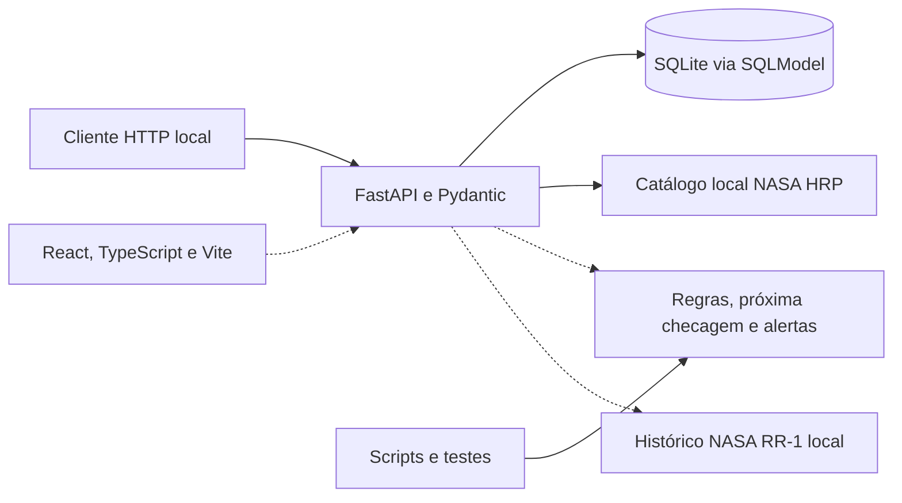

# EP-01 · Fundação e arquitetura

O P0 da ODYSSEY-26 prevê uma missão fictícia em um habitat de Marte, quatro perfis e quatro telas. A jornada planejada passa por Dashboard, Registrar, Histórico e Investigação para registrar medições, comparar evidências, recomendar uma checagem e reanalisar após seu registro. A demonstração usa observações manuais ou sintéticas, hipóteses não confirmadas e revisão humana conforme o protocolo. A AKM-35 prevê múltiplos ambientes como complemento P1. Épico EP-01 (internal Notion page; Portuguese, not part of the submission) · PRD v0.1 e adendo NASA (internal Notion page; Portuguese, not part of the submission) · Arquitetura v2.0 e adendo v2.1 (internal Notion page; Portuguese, not part of the submission)

## Evidência das tarefas de fundação

| Tarefa | Entrega verificável | Evidência |
| --- | --- | --- |
| AKM-01 (internal Notion page; Portuguese, not part of the submission) | Escopo P0 do produto, requisitos funcionais e não funcionais, cenário, proveniência, limites e riscos. | PRD versionado (internal Notion page; Portuguese, not part of the submission) · [Cenário sintético](synthetic-data.md) · [Segurança](../akm-08-alert-safety.md) |
| AKM-02 (internal Notion page; Portuguese, not part of the submission) | Componentes, stack, fronteiras e procedimento de execução local no navegador e servidor. | Arquitetura canônica (internal Notion page; Portuguese, not part of the submission) · [Procedimento local](#verificação-local) · [PR #1](https://github.com/Arturvpf/akm-health/pull/1) |
| AKM-03 (internal Notion page; Portuguese, not part of the submission) | Modelo relacional, erros, contratos Python e TypeScript e dez operações HTTP especificadas. | [Contrato v2](../contracts-v2-review.md) · [Pydantic](../../backend/app/schemas.py) · [TypeScript](../../frontend/src/types.ts) · [Testes de schemas](../../backend/tests/test_response_contracts.py) |
| AKM-04 (internal Notion page; Portuguese, not part of the submission) | Fluxograma, transições, reanálise, tratamento de dados insuficientes e encaminhamento manual. | [Fluxo e roteiro de aceite](akm-04-investigation-flow.md) · [PR #2](https://github.com/Arturvpf/akm-health/pull/2) |
| AKM-05 (internal Notion page; Portuguese, not part of the submission) | Estrutura, contribuição e checagem local reproduzível para cada PR. | [README](../../README.md) · [Ruff, Pytest e TypeScript](../../scripts/check.py) · [PR #2](https://github.com/Arturvpf/akm-health/pull/2) |

## Componentes e integrações

As setas sólidas mostram chamadas disponíveis na base atual. As pontilhadas mostram a composição prevista para o MVP. As funções de investigação também podem ser executadas pelos scripts da demo e pelos testes.



| Decisão | O que cada frente pode usar |
| --- | --- |
| Frontend em React, TypeScript e Vite | Os tipos compartilhados já compilam. A interface consome JSON da API e apresenta texto, ícone, cor e cobertura. As telas e a conexão com o servidor ficam nas AKM-12 a AKM-16. |
| API local com contratos Pydantic | O servidor valida as cinco métricas. O registro TypeScript também associa a unidade à métrica e distingue a identificação do tripulante da zona habitat. Formato de horário, intervalos de valores e existência do perfil são validados pela API. |
| SQLite via SQLModel | A migração v1 cria `astronauts`, `measurements`, `investigations` e `followups`. Chaves estrangeiras, transações e unicidade da fingerprint estão no esquema. O seed pode rodar novamente preservando as leituras anteriores. |
| Investigação determinística em Python | Detectores individual e coletivo, seleção da próxima checagem e apresentação de alertas podem ser exercitados diretamente. A AKM-20 liga os resultados à API e persiste investigação e verificação na mesma transação. A AKM-25 integra a rotina de acompanhamento. |
| Proveniência NASA separada | O catálogo NASA HRP responde localmente. A série histórica RR-1 foi verificada na fonte e a importação fica na AKM-39, com unidade, horário, missão e origem próprios. A evidência da tripulação usa somente medições da missão fictícia. |

[SQLite e migração](../database.md) · [Próxima checagem](akm-23-next-check.md) · [Apresentação de alertas](akm-24-alert-presentation.md) · [Proveniência NASA](ep-05-scientific-foundation-and-safety.md#proveniência-rr-1)

## Operações do contrato

O OpenAPI local expõe sete operações canônicas. A tabela separa o que já é verificável em execução do contrato esperado para investigação e acompanhamento. A rota auxiliar `/api/_contract/validate-measurement` serve à validação do schema.

| Operação | Estado e contrato |
| --- | --- |
| `GET /api/health` | Disponível. Retorna `200` e conectividade SQLite. |
| `GET /api/astronauts` | Disponível. Lista perfis e baselines sintéticas. |
| `GET /api/measurements` | Disponível. Histórico com filtros canônicos de perfil, métrica, `from` e `to`, e paginação por `limit` e `offset`. |
| `POST /api/measurements` | Disponível. Retorna `201` com leitura persistida, zona derivada e horários UTC. Retorna `404` para perfil inexistente e `422` para entrada inválida. |
| `GET /api/dashboard` | Disponível. Lê últimos dados utilizáveis, agenda pendente e indicação de novas medições. A investigação é acionada explicitamente no fluxo previsto. |
| `POST /api/investigations/run` | Prevista na AKM-20. Executa ou reutiliza uma investigação identificada por fingerprint e vincula uma checagem persistida quando aplicável. |
| `GET /api/investigations/{id}` | Prevista na AKM-20. Recupera o resultado persistido e suas evidências. |
| `GET /api/followups` | Disponível. Consulta a agenda persistida com filtros de astronauta e status. |
| `PATCH /api/followups/{id}` | Prevista na integração AKM-20/25. Exige uma leitura registrada depois da solicitação, compatível e utilizável. Repetir com a mesma leitura preserva a conclusão. |
| `GET /api/nasa/references` | Disponível. Retorna referências públicas NASA HRP e série vazia em `not_imported` até a AKM-39. |

## Verificação local

Instale as dependências conforme o [README](../../README.md). Este procedimento usa um SQLite temporário no Windows e o mesmo `AKM_DB_PATH` para o seed e o servidor.

```powershell
$env:AKM_DB_PATH = Join-Path ([System.IO.Path]::GetTempPath()) "akm-ep01-$([guid]::NewGuid()).db"
Push-Location backend
python -m app.seed
python -m app.seed
Pop-Location
python scripts/check.py
python -m uvicorn app.main:app --app-dir backend --host 127.0.0.1 --port 8000
```

A primeira carga deve inserir quatro perfis e 29 medições. A segunda deve inserir zero. Consulte `/api/health`, `/openapi.json` e `/api/measurements` na porta local. Use o [exemplo de registro](../contracts-v2-review.md#registering-a-measurement) para conferir criação, horário UTC e recuperação do histórico depois de reiniciar com o mesmo banco. O teste de tipos checa os cinco pares métrica/unidade, o alvo do tripulante e a nulabilidade no habitat. [Teste TypeScript](../../frontend/src/measurement-contract.test.ts) · [Testes HTTP](../../backend/tests/test_history_api.py)

Após a instalação, a API e o SQLite operam por loopback. O HTML do Swagger carrega recursos de CDN, enquanto `/openapi.json` é servido localmente. A prova no navegador com o frontend do produto pertence à AKM-30. A AKM-05 usa `python scripts/check.py` localmente antes de cada PR, com comandos e resultados registrados na descrição do PR.
