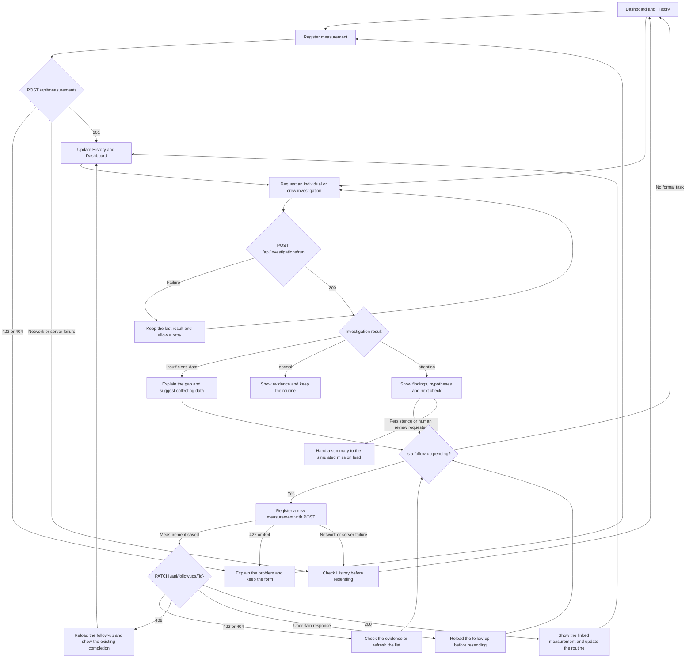

# AKM-04 · End-to-end investigation flow

This specification accompanies architecture v2.0 and addendum v2.1 (internal Notion page; Portuguese, not part of the submission). It uses the evidence and limits from [AKM-07](../scientific-sources.md) to define how the fictional ODYSSEY-26 crew records, interprets, verifies and re-analyzes an observation.

## Flowchart

Loading, empty and error states belong to the interface. In the P0 flow the result is `normal`, `attention` or `insufficient_data`. The `critical` code stays reserved in the contract. Statuses carry text and an icon alongside color.

## Transitions and responsibilities

| Step | Response or state | Expected behavior |
| --- | --- | --- |
| Open the Dashboard | Empty or reading available | Show the empty state with `insufficient_data`. With an empty database and no investigation, `has_unanalyzed_measurements=false`. Load the history with the selected filters and show times and units. |
| Record data | `POST /api/measurements` → 201 | Validate type, unit, target and time. A crew member requires an ID and the habitat uses `null`. The backend derives `measurement_zone` and sets `recorded_at`. Update the history immediately. If valid data is still outside the scope's latest analysis, flag a new measurement and offer the investigate action. |
| Investigate | `POST /api/investigations/run` → 200 | Send `scope=crew` or `scope=individual` with an astronaut. The backend selects the valid inputs, applies the rules version and returns findings, evidence, unconfirmed hypotheses and the next check. Update the Dashboard and allow the result to be retrieved with `GET /api/investigations/{id}`. |
| Repeat the analysis | Same fingerprint, `reused=true` | Keep the investigation ID and its follow-up. With new data, compute another fingerprint. If an equivalent pending follow-up exists for the same kind and target, reuse it. |
| Interpret the result | `normal`, `attention` or `insufficient_data` | `normal` means the rule found no pattern for the evaluated scope. With `attention`, separate observation from hypothesis and show the reason for the next collection. Without enough basis, ask for the missing information. Suspect, absent or out-of-window CO₂ limits the environmental hypothesis and can coexist with a valid sleep finding. |
| Verify | `POST /api/measurements` → 201, then `PATCH /api/followups/{id}` → 200 | Only send `{"status":"completed","measurement_id":123}` after confirming the measurement is persisted. The measurement must have quality `ok`, a `recorded_at` after the request, and a compatible kind, zone and astronaut. The backend returns `measurement_id` and `completed_at`. |
| Retry the completion | 200, 422, 404 or 409 | The same measurement returns the existing completion. An incompatible measurement gets 422 and the item stays pending. With 404, refresh the list and check the IDs. If another measurement already completed the item, 409 and a reload of the current completion. On an uncertain response, reload the follow-up before any other action. |
| Re-analyze and update the routine | New explicit investigation | The completed task leaves the pending list and stays traceable through the measurement. While new evidence exists, show the re-analysis prompt. The new investigation uses all relevant inputs and can keep the pattern, limit the hypothesis or recommend another collection. |

### Failures and human review

- On 422, show the field or condition to correct and keep what was filled in. On 404, reload the resource and let the user select a valid target. On an unexpected failure, keep the last confirmed state and show a retry message.
- If the registration response is lost, check the history before resending, because the write may have completed. Investigation POSTs with identical inputs and the PATCH with the same measurement have their own idempotency guarantees.
- If a valid verification keeps a pattern, if repeated collections fail, or if the simulated crew asks for help, offer human review by the simulated mission lead. The summary includes scope, readings, times, quality, unconfirmed hypotheses, the verification attempt and gaps. The lead decides the referral under the mission protocol. In P0 the hand-off of the summary is manual and the software provides informational support. The alert criteria and final messages belong to AKM-08/09.

## Verification script

This is a desk check of the scenarios and transitions. Running it in a browser with the API, persistence, seed and engine integrated is the AKM-30 QA deliverable.

| Profile | Baseline (h) | Night 1 (h) | Night 2 (h) | Result under the synthetic rule of two readings ≤ 80% of baseline |
| --- | ---: | ---: | ---: | --- |
| A1 Aurora | 8.0 | 5.2 | 5.4 | Individual signal |
| A2 Orion | 7.5 | 5.6 | 5.7 | Individual signal |
| A3 Vega | 8.0 | 5.3 | 5.6 | Individual signal |
| A4 Lyra | 7.8 | 7.7 | 7.9 | No equivalent signal |

1. Use the two distinct nights of sleep above with quality `ok`. Include the internal CO₂ records of 680, 950 and 980 ppm in the demo window. Run a crew investigation. Check `attention`, a pattern in A1/A2/A3, a timing coincidence with explicit uncertainty and a cabin CO₂ follow-up.
2. Repeat with the same inputs. Check the same ID and the same follow-up. Then try to complete the follow-up without a measurement, or with a different kind, a recording time before the request, or quality `suspect`. Check the error and that the item stays `pending`.
3. Record a new synthetic habitat `co2_ppm` reading, quality `ok`, after the request. Use the returned ID to complete the item. Check the link, repeat the PATCH with the same ID and verify the completion stays the same. Run a new investigation and check that the new evidence changes the fingerprint. The result follows from the updated windows and data and may keep the hypothesis open.
4. Check the variants of the [AKM-07 matrix](../scientific-sources.md#check-against-odyssey-26). With the environment absent, suspect or out of the window, there is a sleep finding without a sustained environmental hypothesis. With fewer than two profiles with enough readings in the crew scope, the return is `insufficient_data`. With enough valid records and only A1 below the reference, the finding can be individual and the crew rule shows no pattern.
5. Simulate a server failure during registration and a network failure after the PATCH. Check that the form and the last known result are preserved and that the state is revalidated before resending.
