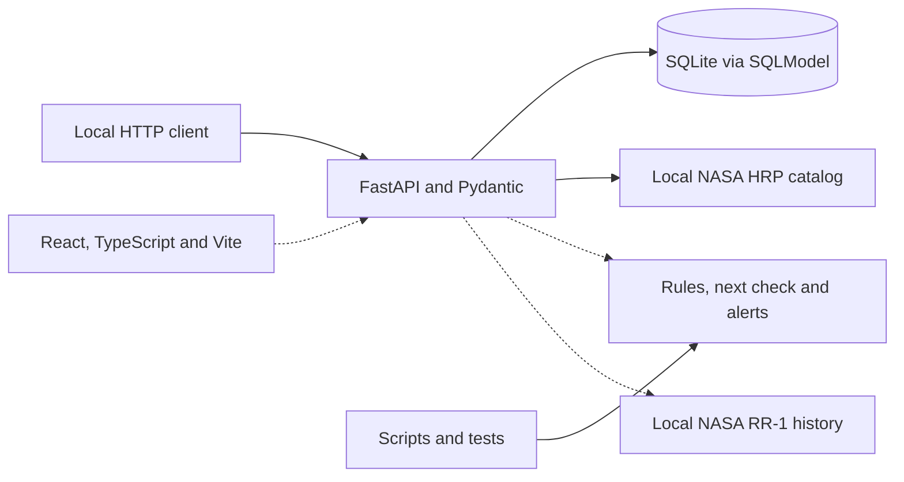

# EP-01 · Foundation and architecture

The ODYSSEY-26 P0 envisions a fictional mission in a Mars habitat, four profiles and four screens. The planned journey goes through Dashboard, Register, History and Investigation to record measurements, compare evidence, recommend a check and re-analyze after it is recorded. The demonstration uses manual or synthetic observations, unconfirmed hypotheses and human review according to the protocol. AKM-35 plans multiple environments as a P1 complement. Epic EP-01 (internal Notion page; Portuguese, not part of the submission) · PRD v0.1 and NASA addendum (internal Notion page; Portuguese, not part of the submission) · Architecture v2.0 and addendum v2.1 (internal Notion page; Portuguese, not part of the submission)

## Evidence for the foundation tasks

| Task | Verifiable deliverable | Evidence |
| --- | --- | --- |
| AKM-01 (internal Notion page; Portuguese, not part of the submission) | Product P0 scope, functional and non-functional requirements, scenario, provenance, limits and risks. | Versioned PRD (internal Notion page; Portuguese, not part of the submission) · [Synthetic scenario](synthetic-data.md) · [Safety](../akm-08-alert-safety.md) |
| AKM-02 (internal Notion page; Portuguese, not part of the submission) | Components, stack, boundaries and local run procedure in the browser and server. | Canonical architecture (internal Notion page; Portuguese, not part of the submission) · [Local procedure](#local-verification) · [PR #1](https://github.com/Arturvpf/akm-health/pull/1) |
| AKM-03 (internal Notion page; Portuguese, not part of the submission) | Relational model, errors, Python and TypeScript contracts and ten specified HTTP operations. | [Contract v2](../contracts-v2-review.md) · [Pydantic](../../backend/app/schemas.py) · [TypeScript](../../frontend/src/types.ts) · [Schema tests](../../backend/tests/test_response_contracts.py) |
| AKM-04 (internal Notion page; Portuguese, not part of the submission) | Flowchart, transitions, re-analysis, handling of insufficient data and manual referral. | [Flow and acceptance script](akm-04-investigation-flow.md) · [PR #2](https://github.com/Arturvpf/akm-health/pull/2) |
| AKM-05 (internal Notion page; Portuguese, not part of the submission) | Structure, contribution and a reproducible local check for each PR. | [README](../../README.md) · [Ruff, Pytest and TypeScript](../../scripts/check.py) · [PR #2](https://github.com/Arturvpf/akm-health/pull/2) |

## Components and integrations

Solid arrows show calls available in the current base. Dotted arrows show the composition planned for the MVP. The investigation functions can also be run by the demo scripts and by the tests.



| Decision | What each workstream can use |
| --- | --- |
| Frontend in React, TypeScript and Vite | The shared types already compile. The interface consumes JSON from the API and presents text, icon, color and coverage. The screens and the server connection belong to AKM-12 to AKM-16. |
| Local API with Pydantic contracts | The server validates the five metrics. The TypeScript record also associates the unit with the metric and distinguishes the crew member's identification from the habitat zone. Time format, value ranges and profile existence are validated by the API. |
| SQLite via SQLModel | Migration v1 creates `astronauts`, `measurements`, `investigations` and `followups`. Foreign keys, transactions and fingerprint uniqueness are in the schema. The seed can run again while preserving earlier readings. |
| Deterministic investigation in Python | The individual and collective detectors, next-check selection and alert presentation can be exercised directly. AKM-20 connects the results to the API and persists investigation and check in the same transaction. AKM-25 integrates the follow-up routine. |
| Separate NASA provenance | The NASA HRP catalog responds locally. The RR-1 historical series was verified at the source and the import stays in AKM-39, with its own unit, time, mission and origin. Crew evidence uses only measurements from the fictional mission. |

[SQLite and migration](../database.md) · [Next check](akm-23-next-check.md) · [Alert presentation](akm-24-alert-presentation.md) · [NASA provenance](ep-05-scientific-foundation-and-safety.md#rr-1-provenance)

## Contract operations

The local OpenAPI exposes seven canonical operations. The table separates what is already verifiable at runtime from the contract expected for investigation and follow-up. The auxiliary route `/api/_contract/validate-measurement` serves schema validation.

| Operation | State and contract |
| --- | --- |
| `GET /api/health` | Available. Returns `200` and SQLite connectivity. |
| `GET /api/astronauts` | Available. Lists profiles and synthetic baselines. |
| `GET /api/measurements` | Available. History with canonical filters for profile, metric, `from` and `to`, and pagination by `limit` and `offset`. |
| `POST /api/measurements` | Available. Returns `201` with the persisted reading, derived zone and UTC times. Returns `404` for a nonexistent profile and `422` for invalid input. |
| `GET /api/dashboard` | Available. Reads the latest usable data, pending agenda and the indication of new measurements. The investigation is triggered explicitly in the planned flow. |
| `POST /api/investigations/run` | Planned in AKM-20. Runs or reuses an investigation identified by fingerprint and links a persisted check when applicable. |
| `GET /api/investigations/{id}` | Planned in AKM-20. Retrieves the persisted result and its evidence. |
| `GET /api/followups` | Available. Queries the persisted agenda with astronaut and status filters. |
| `PATCH /api/followups/{id}` | Planned in the AKM-20/25 integration. Requires a reading registered after the request, compatible and usable. Repeating with the same reading preserves the completion. |
| `GET /api/nasa/references` | Available. Returns public NASA HRP references and an empty series in `not_imported` until AKM-39. |

## Local verification

Install the dependencies as in the [README](../../README.md). This procedure uses a temporary SQLite database on Windows and the same `AKM_DB_PATH` for the seed and the server.

```powershell
$env:AKM_DB_PATH = Join-Path ([System.IO.Path]::GetTempPath()) "akm-ep01-$([guid]::NewGuid()).db"
Push-Location backend
python -m app.seed
python -m app.seed
Pop-Location
python scripts/check.py
python -m uvicorn app.main:app --app-dir backend --host 127.0.0.1 --port 8000
```

The first load must insert four profiles and 29 measurements. The second must insert zero. Query `/api/health`, `/openapi.json` and `/api/measurements` on the local port. Use the [registration example](../contracts-v2-review.md#registering-a-measurement) to check creation, UTC time and retrieval of the history after restarting with the same database. The type test checks the five metric/unit pairs, the crew-member target and nullability in the habitat. [TypeScript test](../../frontend/src/measurement-contract.test.ts) · [HTTP tests](../../backend/tests/test_history_api.py)

After installation, the API and SQLite run over loopback. The Swagger HTML loads CDN resources, while `/openapi.json` is served locally. Proof in the browser with the product frontend belongs to AKM-30. AKM-05 uses `python scripts/check.py` locally before each PR, with commands and results recorded in the PR description.
